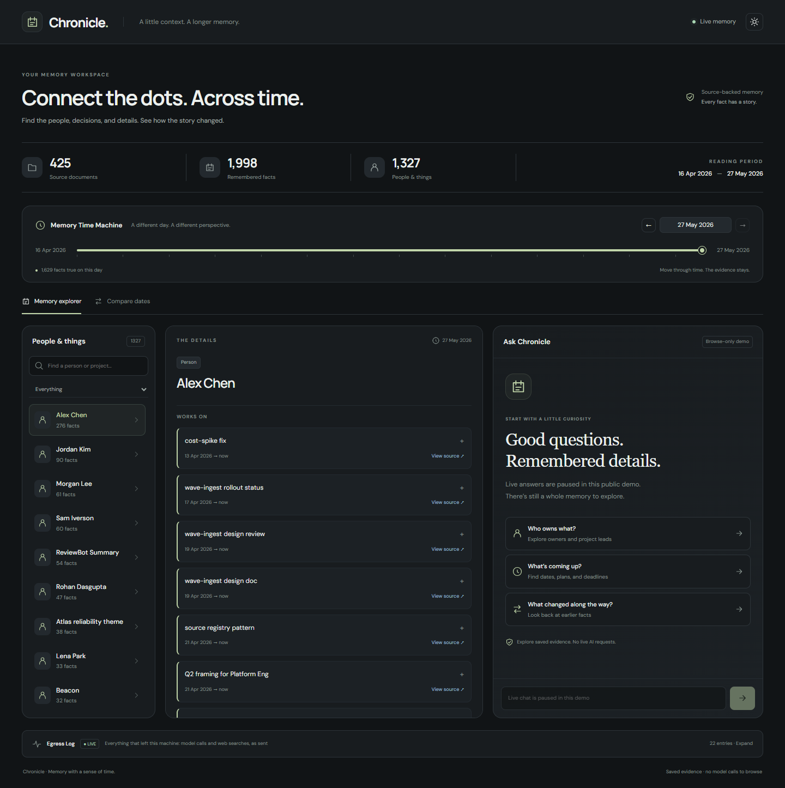

# Chronicle

A personal AI agent whose memory keeps up.

Chronicle's memory is **bi-temporal**: every fact records when it was true
(`valid_from` / `valid_to`) and when Chronicle learned it. Facts are never
deleted. When Bob takes over the payments service from Alice, Alice's fact is
closed rather than overwritten, so "who owned payments on 3 May?" still has the
right answer. Personal data is pseudonymised before any call leaves the machine.

**Nebius x NVIDIA Global AI Hackathon, Personal AI track.**
[Live demo](TODO) · [Video](TODO) · [Devpost write-up](docs/devpost.md) ·
[Benchmark results](docs/benchmark-results.md) · [Architecture](docs/architecture.md)



## Results

On NVIDIA's Agent Memory Benchmark (corpus A, 186 questions), with the same model (Nemotron 3
Ultra), corpus and grader as NVIDIA's reference runs:

| System | Overall |
|---|---:|
| NVIDIA agentic RAG (reference) | 0.828 |
| NVIDIA self-model (reference) | 0.909 |
| **Chronicle, every name masked** | **0.946** |
| **Chronicle, privacy off** | **0.957** |

Runs vary by about ±2 points, and we never read the gold answers. Details and caveats are in
[docs/benchmark-results.md](docs/benchmark-results.md).

## Built on NVIDIA Nemotron and Nebius Token Factory

Every model call goes to **NVIDIA Nemotron on Nebius Token Factory** through one guarded client
(`chronicle/guard/llm_client.py`):

| Model | Used for |
|---|---|
| Nemotron 3.5 Lightning (`nvidia/Nemotron-3_5-Lightning`) | Fact extraction at ingest, development (425 documents in about 8 minutes, under $1) |
| Nemotron 3 Ultra (`nvidia/Nemotron-3-Ultra-550b-a55b`) | Answering, topic consolidation and every reported benchmark run |

Switching models is one environment variable (`CHRONICLE_MODEL`); Token Factory's
OpenAI-compatible endpoint meant there was nothing to host.

## How it works

| Piece | What it does |
|---|---|
| Ingest (P1) | Parses email, chat, calendar and markdown into events and facts |
| Memory (P2) | Bi-temporal store with `as_of()` queries |
| Reason (P3) | Plans, retrieves and answers with citations; abstains when unsure |
| Guard (P4) | PII detection, pseudonymisation, the shared LLM client, egress log |
| UI (P4) | Memory Time Machine: drag a date slider and watch facts change |
| Deploy (P4) | Hermes Agent plugin, OpenShell egress lockdown, one-command install |

Design: [docs/architecture.md](docs/architecture.md).

## Quick start

Needs Python 3.11+, [uv](https://docs.astral.sh/uv/) and Node 18+.

```bash
git clone https://github.com/Opustron66/Opustron.git
cd Opustron
uv sync --extra dev
cp .env.example .env        # then fill in NEBIUS_API_KEY
set -a; source .env; set +a # Chronicle does not load .env by itself
uv run pytest
```

| Variable | Used for |
|---|---|
| `NEBIUS_API_KEY` | Nebius Token Factory (all model calls), required |
| `CHRONICLE_MODEL` | Defaults to `nvidia/Nemotron-3_5-Lightning`; use `nvidia/Nemotron-3-Ultra-550b-a55b` for official benchmark runs |
| `CHRONICLE_MAX_TOKENS` | Completion budget (16384); reasoning tokens count toward it |
| `TAVILY_API_KEY` | Web enrichment (optional) |

Every other switch is in [docs/configuration.md](docs/configuration.md). To host the UI and API,
see [docs/deployment.md](docs/deployment.md).

## Run it

**Ingest a corpus** (P1). Text is pseudonymised before it reaches Nebius:

```bash
uv run python -m chronicle.ingest --corpus tests/fixtures/corpus/part_a --state .tmp/chronicle
```

**Query memory** (P2):

```python
from chronicle.memory import MemoryAPI

memory = MemoryAPI.from_state(".tmp/chronicle")
memory.holder_at("owns", "payments service", "2026-05-03").subject   # "Alice Chen"
```

**Answer benchmark questions** (P3):

```bash
echo '{"id":"q1","question":"Who owns payments?"}' | uv run python adapters/chronicle/answer.py --state .tmp/chronicle
```

Adapter details and answer rules: [docs/answering.md](docs/answering.md).

## Memory Time Machine UI

```bash
uv run python -m chronicle.memory serve --state .tmp/chronicle   # API on :8000, with NEBIUS_API_KEY loaded for chat
cd ui && npm install && npm run dev                              # http://localhost:5173
uv run python -m chronicle.guard.egress_server                   # optional: live egress log on :8001
```

- **Real data:** with the memory server running, the header shows `● Live memory · N facts`; without it the views show labelled sample data.
- **Handover days:** `valid_to` is the first day a fact is no longer true, so on a handover day only the new owner is current.
- **Chat:** `POST /api/ask` answers through the privacy guard, using the slider's date unless the question names one.
- **Citations:** answers show source document IDs as chips; no matching evidence gives "Not in the corpus" without a model call.
- **Errors:** failed requests show an error and never fall back to a sample answer.
- **Egress log:** the bottom panel shows `● LIVE` model calls and web searches with redaction badges, or `sample data` without the server.

Endpoints: [docs/architecture.md](docs/architecture.md#http-api). Chat date rules:
[docs/answering.md](docs/answering.md#chat-in-the-ui).

## Rules for contributors

- **Call models only through `chronicle.guard.llm`.** It pseudonymises PII, caches responses and
  logs every call. CI (`tests/guard/test_egress_boundary.py`) fails on network imports outside
  `chronicle/guard/`. Details: [docs/privacy.md](docs/privacy.md).

  ```python
  from chronicle.guard import llm

  text = llm.complete([{"role": "user", "content": "Summarise Alice's email"}])
  ```

- Branch from `main` as `p<N>/<topic>` and open a PR.
- Every PR needs one approving review from someone in a different role before merging.
- Every PR adds tests for what it changes and updates the docs when setup or behaviour changes.
- Never look at the benchmark's gold answers while developing.

## Running in a sandbox with Hermes Agent

Chronicle plugs into [Hermes Agent](https://hermes-agent.nousresearch.com) as its memory provider
and runs inside an NVIDIA OpenShell sandbox via NemoClaw.

```bash
# Inside the sandbox (nemoclaw <sandbox> connect), or wherever Hermes runs:
./deploy/install.sh
hermes memory setup                  # choose "chronicle"

# On the host: allow Chronicle's two hosts on top of the sandbox's policy (dev)
./deploy/install.sh --sandbox <sandbox>

# On the host: lock the sandbox down to Token Factory + Tavily only (demo)
./deploy/install.sh --sandbox <sandbox> --lockdown
```

Install before `--lockdown` (it blocks PyPI); see what the policy blocked with
`openshell logs <sandbox> --source sandbox`. `deploy/openshell-policy.yaml` is the full policy
and `deploy/presets/chronicle.yaml` the NemoClaw preset. The agent gets `chronicle_recall`
(`as_of: YYYY-MM-DD` for a past date), `chronicle_remember` and, with `TAVILY_API_KEY`,
`chronicle_web_search`. Memory persists in `$HERMES_HOME/chronicle/memory.sqlite3`; set
`CHRONICLE_MEMORY_DB` to the UI's `DIR/memory.sqlite3` to share one store. Details:
[deploy/hermes-plugin/chronicle/README.md](deploy/hermes-plugin/chronicle/README.md).

## Tests

```bash
uv run pytest            # Python: guard, memory, ingest, deploy policy, Hermes plugin
cd ui && npm test        # UI
```

CI runs both on every push and pull request.

## Repo layout

```
chronicle/
  ingest/        P1  parsers, extraction, entity resolution, temporal normalisation
  memory/        P2  bi-temporal store, search, supersession
  reason/        P3  planner, retriever, answerer, abstention
  guard/         P4  PII detection, pseudonymiser, privacy router, LLM client, egress log
  integrations/  P4  Hermes memory provider, Tavily
  schema.py          shared models (Event, Entity, Source)
adapters/        NVIDIA Agent Memory Benchmark adapter
eval/            benchmark runner, ablations, failure analysis
ui/              P4  Memory Time Machine (React + Vite)
deploy/          P4  install script, OpenShell policy and preset, Hermes plugin
docs/            architecture, benchmark results, demo script
```

## Docs

| Doc | Covers |
|---|---|
| [architecture.md](docs/architecture.md) | Layers, handoffs, the bi-temporal store, HTTP API |
| [answering.md](docs/answering.md) | Benchmark adapter, retrieval, answer rules |
| [privacy.md](docs/privacy.md) | Guard client, PII detection, Tavily, egress log |
| [configuration.md](docs/configuration.md) | Every environment variable |
| [benchmark-results.md](docs/benchmark-results.md) | Scores, run history, caveats |
| [deployment.md](docs/deployment.md), [free-chat.md](docs/free-chat.md) | Hosting on Render, chat budget |
| [devpost.md](docs/devpost.md) | Hackathon submission text |
