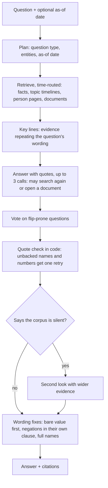
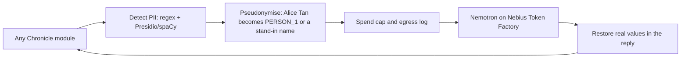

# Architecture

Chronicle is organized into ingestion, temporal memory, reasoning, privacy, and
integration layers. The layers communicate through the shared models in
`chronicle.schema`.

```
documents ──P1 ingest──▶ state/claims.jsonl ──P2 sync──▶ state/memory.sqlite3
                                                              │
                         P3 reason (search, holder_at) ◀──────┤
                         P4 Hermes (SQLiteBackend)     ◀──────┤
                         P4 UI (/api/entities, /api/facts) ◀──┘
```

## Answering a question (P3)

Most of the accuracy comes from this pipeline. Every model call in it goes through the guard below.



## Privacy guard (P4)



Dates are deliberately not masked, because Chronicle reasons about when facts were true. CI fails
if code outside `chronicle/guard/` imports an HTTP client, so no call can bypass the guard. Web
searches (Tavily) cannot be pseudonymised, so a query that identifies a person is refused.

## Handoffs

| From → to | Contract |
|---|---|
| P1 → P2 | `Claim` (`chronicle/schema.py`), appended to `state/claims.jsonl` by `python -m chronicle.ingest` |
| P2 → P3 | `MemoryAPI` (`chronicle/memory/api.py`): `search`, `as_of`, `holder_at`, `value_at`, `history`; `Fact.to_claim()` returns P1's `Claim` with `doc_id` and `quote` |
| P2 → P4 Hermes | `SQLiteBackend` (`chronicle/memory/backend.py`) implements `ChronicleBackend` |
| P2 → P4 UI | HTTP routes in `chronicle/memory/server.py`, served by `python -m chronicle.memory serve` |

P1's CLI is unchanged. `MemoryAPI.from_state(state)` loads any claims in
`claims.jsonl` it has not stored yet, so ingesting part A and then part B in separate
processes just works. Each claim is hashed, so re-reading the file is a no-op.

## Memory (P2): the bi-temporal store

SQLite, one file per state directory (`state/memory.sqlite3`). The schema is in
`chronicle/memory/migrations/`, and new `NNNN_*.sql` files apply automatically
(`PRAGMA user_version`).

### Two clocks

- **Valid time** (`valid_from`, `valid_to`): when the fact was true in the world.
  Intervals are half-open. On a handover day the new owner holds and the old one does
  not. `NULL` `valid_from` means unknown start; `NULL` `valid_to` means still true.
- **Transaction time** (`recorded_at`, `replaced_at`): when Chronicle believed it.
  Changing a fact's validity never updates it in place. The current row gets a
  `replaced_at` and a new version is inserted.

`as_of(day)` asks what was true on that day. `as_of(day, known_at=t)` asks what
Chronicle thought, at time `t`, was true on that day. That lets you show how a later
email changed an earlier answer. A bare date means the end of that day.

### Tables

| Table | Holds |
|---|---|
| `facts` | Versions of each fact: triple, content, validity, `superseded_by`, `end_reason` (`stated`, `superseded`, `retired`) |
| `fact_sources` | Every statement behind a fact: `doc_id`, verbatim `quote`, `observed_at`, role (`opened`, `restated`, `closed`) |
| `entities`, `entity_aliases` | Subjects and entity-like objects, with alias lookup |

Facts are never deleted. A restatement in a later document adds a source, not a new
fact. P1's closing claim for a handover (valid_from empty, valid_to set) is merged
into the fact it closes, whichever arrives first.

### Supersession (`chronicle/memory/supersession.py`)

| Predicates | One value per | Example |
|---|---|---|
| `owns`, `leads`, `manages`, `maintains` | object | Dana owns payments → Alice's ownership ends |
| `status`, `role`, `reports_to`, `works_at`, `located_in`, `owner`, `lead`, `on_call`, … | subject | migration status done → blocked ends |
| `deadline`, `scheduled_for` | subject, from when it was *said* | "moved to 1 May" replaces "due 24 Apr" from the day of the email |
| everything else (`works_on`, `member_of`, …) | many at once | ends only when a source says so |

A fact in a slot ends at the earlier of two dates: its stated end, or the start of the
next different value. The slot is recomputed from all its facts on every write, so
the answers don't depend on ingestion order. If two values start the same day, the
one stated later wins. A fact whose start is unknown is never superseded.

### Search

BM25 over subject, predicate, object, content and every source quote.
`search(q, as_of=day)` limits results to facts true then. Without `as_of`,
superseded facts are included, because questions like "who owned payments before
Dana?" need them.

### Notes

Free-text Hermes memories are stored as `kind = 'note'` facts at instant precision.
`remember_note(..., supersedes=)` and `retire_note` close them the same way.
